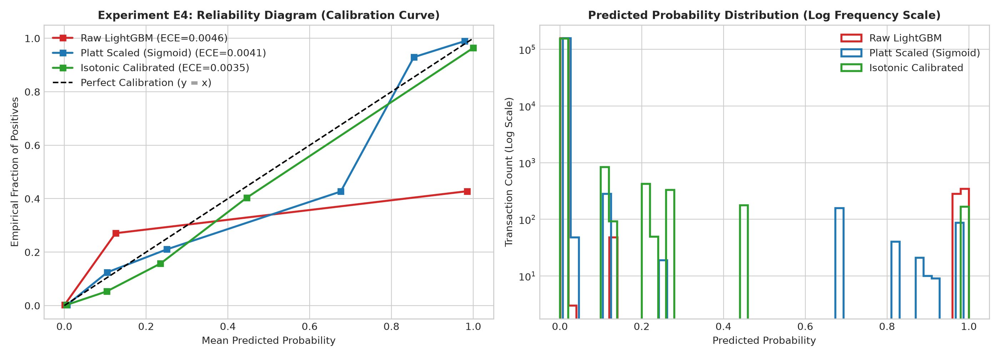
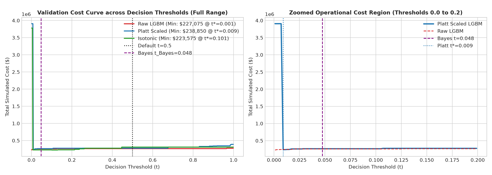
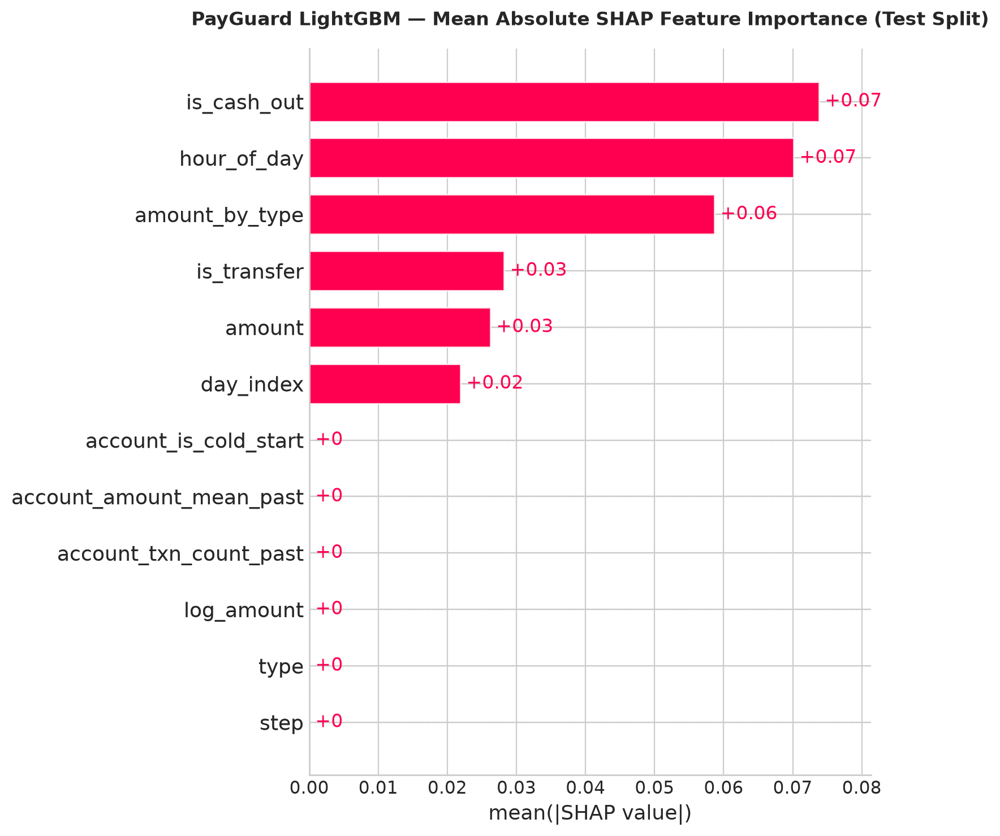

# PayGuard: Cost-Sensitive Fraud Decisioning under Temporal Shift

Standard fraud classifiers optimize ranking metrics or apply a fixed 0.5 probability threshold. On 6.36M PaySim transactions (0.129% fraud rate), we evaluate whether probability calibration combined with a capacity-constrained three-action decision policy (Approve / Manual Review / Decline) outperforms binary thresholding on a held-out future period. This repository is an offline methodology study on synthetic mobile-money data to quantify the operational cost trade-offs between false declines and fraud losses under severe class imbalance.

---

## Key Empirical Findings

All evaluations below were run on the held-out chronological test period (`steps 595 to 743`, 123,580 transactions, 1,654 actual frauds, 1.3384% prevalence).

### Table 1: Ranking and Probability Calibration

| Model | Features | Calibration | Average Precision (AP) | ROC-AUC | Brier Score | Log Loss | ECE (10 Bins) | Precision @ 0.5 | Recall @ 0.5 | Fraud Value Captured (%) |
| :--- | :--- | :--- | :---: | :---: | :---: | :---: | :---: | :---: | :---: | :---: |
| Logistic Regression | Tier 2 | None (Unweighted) | 0.2371 | 0.9093 | 0.013204 | 0.0631 | 0.0128 | 0.00% | 0.00% | 0.00% |
| LightGBM | Tier 1 (Raw Safe) | None | 0.0134 | 0.5000 | 0.013384 | 0.0694 | 0.0134 | 0.00% | 0.00% | 0.00% |
| LightGBM | Tier 2 (Engineered) | None | 0.4068 | 0.7601 | 0.009763 | 0.0693 | 0.0089 | 84.38% | 32.35% | 57.75% |
| LightGBM | Tier 2 (Engineered) | Platt Scaling (Sigmoid) | 0.4068 | 0.7601 | 0.009820 | 0.0535 | 0.0027 | 90.54% | 27.21% | 56.38% |

Tier 1 raw features (`type`, `amount`, `step`) yield AP = 0.0134, matching test set prevalence (0.0134) with zero ranking power across time steps. Point-in-time engineered features (Tier 2) lift AP to 0.4068. Platt scaling reduces Expected Calibration Error from 0.0089 to 0.0027 and log loss from 0.0693 to 0.0535, adjusting probabilities to align with empirical positive rates.

### Table 2: Decision Policy Evaluation under Cost Parameters

Cost assumptions: $C_{\text{miss}} = \$500$, $C_{\text{decline}} = \$25$, $C_{\text{review}} = \$5$. Total cost: $C = C_{\text{miss}} N_{\text{miss}} + C_{\text{decline}} N_{\text{false decline}} + C_{\text{review}} N_{\text{review}}$.

| Policy | Threshold Mechanism | Total Cost ($) | Cost / Txn ($) | Caught Fraud | Recall (%) | Missed Fraud (FN) | False Declines (FP) | Reviews (K) | Fraud Value Captured (%) |
| :--- | :--- | :---: | :---: | :---: | :---: | :---: | :---: | :---: | :---: |
| LogReg | Fixed $t = 0.5$ | $827,000 | $6.69 | 0 | 0.00% | 1,654 | 0 | 0 | 0.00% |
| LightGBM Raw | Fixed $t = 0.5$ | $561,975 | $4.55 | 535 | 32.35% | 1,119 | 99 | 0 | 57.75% |
| LightGBM Calibrated | Fixed $t = 0.5$ | $603,175 | $4.88 | 450 | 27.21% | 1,204 | 47 | 0 | 56.38% |
| LightGBM Calibrated | Validation Sweep $t^* = 0.0090$ | $519,675 | $4.21 | 635 | 38.39% | 1,019 | 407 | 0 | 60.99% |
| LightGBM Calibrated | Bayes Optimal $t = 0.0476$ | $561,975 | $4.55 | 535 | 32.35% | 1,119 | 99 | 0 | 57.75% |
| LightGBM Calibrated | 3-Action (Capacity $K = 500$) | $544,775 | $4.41 | 570 | 34.46% | 1,084 | 11 | 500 | 59.67% |
| LightGBM Calibrated | 3-Action (Capacity $K = 1000$) | $513,550 | $4.16 | 635 | 38.39% | 1,019 | 11 | 755 | 60.99% |

A standard $t = 0.5$ threshold misses all fraud on Logistic Regression ($827,000 cost) and catches only 32.35% on LightGBM. Sweeping the threshold to $t^* = 0.0090$ catches 635 frauds (60.99% of fraud dollars) but generates 407 false declines. Introducing a review queue ($K = 1000$) retains the exact same 635 caught frauds while cutting false declines from 407 to 11 (a 97.3% drop in false declines), delivering the lowest net cost of $513,550 ($4.16/txn).

---

## Technical Methodology

### Data Leakage Audit
In PaySim, `newbalanceOrig == 0` in 98.05% of frauds (8,053 / 8,213), and `amount == oldbalanceOrg` in 97.82% of frauds. A single decision tree split on balance fields scores 0.999 AUC because PaySim zeroes out balances upon fraud transaction completion. In an online pre-authorization flow, settlement balances have not updated. All balance columns (`oldbalanceOrg`, `newbalanceOrig`, `oldbalanceDest`, `newbalanceDest`) and `isFlaggedFraud` are permanently excluded.

### Temporal Partitioning and Prevalence Shift
Transactions are ordered strictly by simulation hour (`step` 1 to 743). A given step is never split across periods:

| Split | Steps | Duration (Hours) | Row Count | Fraud Count | Prevalence (%) | Purpose |
| :--- | :---: | :---: | :---: | :---: | :---: | :--- |
| Train | 1 to 446 | 446 (60.0%) | 3,818,485 | 4,909 | 0.1286% | Base model training |
| Calibration | 447 to 520 | 74 (10.0%) | 760,776 | 827 | 0.1087% | Fitting 1D probability calibrator |
| Validation | 521 to 594 | 74 (10.0%) | 1,659,779 | 823 | 0.0496% | Early stopping and threshold search |
| Test (Locked) | 595 to 743 | 149 (20.0%) | 123,580 | 1,654 | 1.3384% | Final out-of-time evaluation |

Legitimate background volume drops after step 400 in PaySim, causing positive prevalence to surge from 0.0496% in validation to 1.3384% in test (a 27x relative increase). This setup tests whether threshold selection transfers under temporal drift.

### Causal Point-in-Time Features
Features were computed in under 16 seconds on CPU using vectorized expanding operations:
- `amount_by_type`: Ratio of current `amount` to the expanding mean amount for that transaction type strictly prior to the current row. Row $i$ subtracts its own amount from the cumulative sum to prevent current-row leakage.
- `account_txn_count_past`: Number of transactions initiated by `nameOrig` strictly prior to the current event.
- `account_amount_mean_past`: Expanding average amount for `nameOrig` strictly prior to the current event (unseen accounts set to -1.0).
- `account_is_cold_start`: Binary flag for first-seen originating accounts.
- `hour_of_day`: `step % 24` capturing diurnal cycle.

Invariance against future information was verified by unit tests in `tests/test_features.py`, asserting that mutating row $t+1$ has zero effect on features calculated at row $t$.

### Empirical Diagnostic Plots


*Figure 1: Reliability curves showing uncalibrated LightGBM vs. Platt scaling (Sigmoid) on validation data.*


*Figure 2: Simulated operating loss as a function of decision threshold across asymmetric cost ratios.*


*Figure 3: Mean absolute SHAP values across test transactions, showing `amount_by_type` as the primary driver.*

---

## Real-World Limitations and Production Gaps

1. **38.39% Recall Ceiling on First-Time Accounts**: In PaySim, 99.8% of originating accounts transact only once. When a fraudster initiates a transfer from a newly created account with a modest amount (<$100,000), expanding velocity features default to cold-start priors (-1.0). Without device fingerprints, IP reputation, or account-age metadata, the model cannot distinguish these transactions from genuine consumer retail activity.
2. **Batch vs. Streaming Feature Store**: The expanding window calculations in this repository run as vectorized in-memory NumPy/Pandas transforms over batch data. In a live payment gateway operating under a <50ms SLA, computing expanding account counts and category means requires an operational feature store (e.g., Redis or Feast) with atomic increment operations.
3. **Chargeback Label Latency**: PaySim provides immediate ground-truth fraud labels. In live credit card and ACH networks, chargebacks take 30 to 90 days to settle. Production calibration and threshold tuning must account for delayed feedback and label maturity windows.
4. **Synthetic Data Boundaries**: PaySim is an agent-based simulation calibrated to mobile money logs from an African telecommunications provider. It lacks merchant category codes (MCC), card-not-present EMV 3DS cryptograms, and geographic distance signals.

---

## Repository Structure

```
PayGuard/
├── data/
│   └── sample/
│       └── test_cases_sample.parquet   # 500-row demo sample with verified SHAP edge cases
├── models/
│   └── lgbm_calibrated.joblib          # Frozen production calibrated LightGBM model
├── notebooks/
│   ├── 01_eda_and_leakage_audit.ipynb
│   ├── 02_feature_engineering_eda.ipynb
│   ├── 03_modeling_ablation_and_calibration.ipynb
│   ├── 04_cost_decision_and_final_test.ipynb
│   └── 05_explainability_and_error_analysis.ipynb
├── reports/
│   ├── figures/                        # 20 diagnostic plots
│   └── technical_report.md             # In-depth technical analysis
├── src/
│   ├── app/app.py                      # Interactive decision policy simulator
│   ├── data/ingest.py                  # Downcasting and schema enforcement
│   ├── data/splits.py                  # Chronological step partitioning
│   ├── decision/policy.py              # Cost engine, Bayes threshold, 3-action queue
│   ├── features/pipeline.py            # Point-in-time feature extraction
│   └── models/
│       ├── metrics.py                  # AP, ECE, Brier score, fraud value capture
│       └── train.py                    # LightGBM fitting and CausalCalibrator
├── tests/                              # Pytest suite (28 passing tests)
├── pyproject.toml
├── requirements.txt
└── README.md
```

---

## Quickstart

### 1. Environment Setup
```bash
git clone https://github.com/your-username/PayGuard.git
cd PayGuard

python -m venv .venv
# Windows:
.\.venv\Scripts\activate
# Linux/macOS:
source .venv/bin/activate

pip install -r requirements.txt
pip install -e .
```

### 2. Run Test Suite
```bash
pytest
```
Expected output: 28 passed in ~5 seconds.

### 3. Launch Interactive Decision Simulator
The application runs directly on the bundled 500-row test sample (`data/sample/test_cases_sample.parquet`):
```bash
streamlit run src/app/app.py
```

### 4. Reproduce from Raw CSV (Optional)
If running against the full 6.36M-row PaySim dataset:
1. Download `PS_20174392719_1491204439457_log.csv` from Kaggle into `data/raw/`.
2. Ingest and downcast to Parquet:
   ```bash
   python -c "from src.data.ingest import ingest_paysim_csv; ingest_paysim_csv('data/raw/PS_20174392719_1491204439457_log.csv')"
   ```
3. Execute the experiment notebooks:
   ```bash
   python scripts/execute_notebook.py notebooks/01_eda_and_leakage_audit.ipynb
   python scripts/execute_notebook.py notebooks/02_feature_engineering_eda.ipynb
   python scripts/execute_notebook.py notebooks/03_modeling_ablation_and_calibration.ipynb
   python scripts/execute_notebook.py notebooks/04_cost_decision_and_final_test.ipynb
   python scripts/execute_notebook.py notebooks/05_explainability_and_error_analysis.ipynb
   ```
